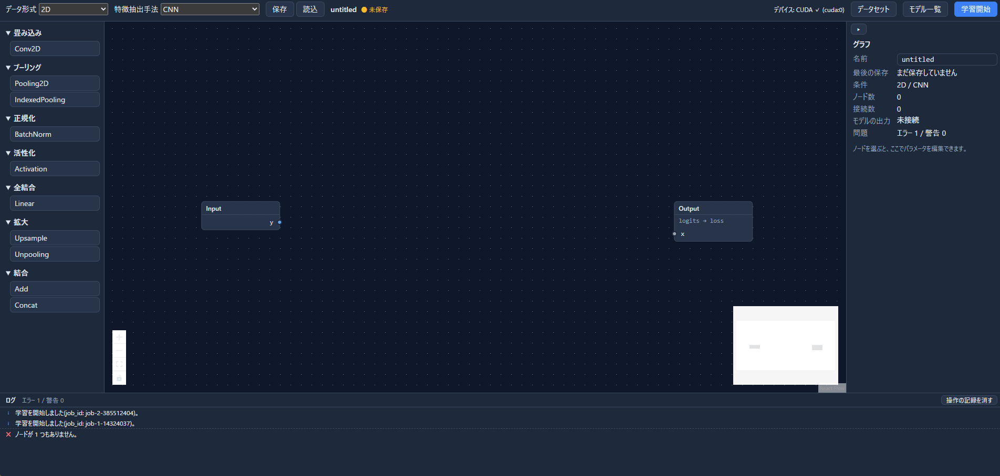
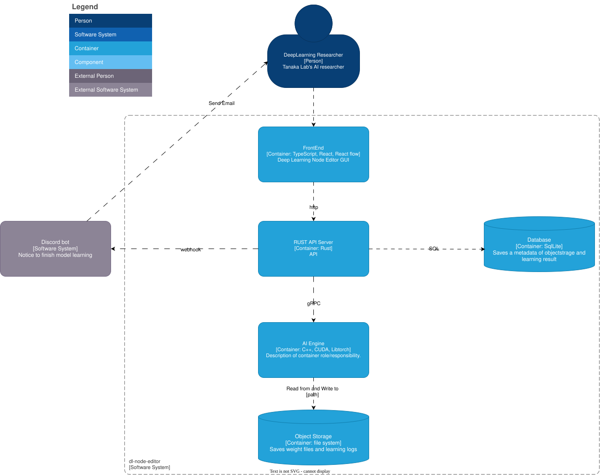

#  DNE: Deep Learning Node Editor　
---
ノーコードで目標のタスクに適したAIモデルの構築ができるアプリケーション



## 構成


## 必要環境

### 共通

|項目|要件|
|---|---|
| OS | Linux (x86_64)、または Windows 11 + WSL2 |
| CPUアーキテクチャ | x86_64(ARM)|
|GPU| NVIDIA GPU(CUDA 13 対応)|
|NVIDIAドライバ| CUDA 13.2に対応するバージョン|
|Docker| Docker Engine + Docker Compose v2|
|GPUコンテナ実行| Nvidia Container Toolkit(Linuxの場合)|
|メモリ| 16GB以上|
|ブラウザ| edge / chromeなど|

> Windows の場合は Docker Desktop(WSL2 バックエンド)を使用
> GPU ドライバは Windows 側にインストールすれば WSL2 からも利用可能。

## 起動方法

1. コンテナ起動&サーバー立ち上げ
```powershell
docker compose -f .deploy/compose.prod.yml up -d
```
2. chrome，edgeのアドレスバーに`http://localhost:25812`を入力

※コンテナの停止
```powershell
docker compose -f .deploy/compose.prod.yml down
```

## 処理の設定

`.deploy/.env` で以下の値を設定できます。

| 環境変数 | 意味 | 既定値 |
|---|---|---|
| `AI_ENGINE_CPUS` | ai-engine(AI 学習)が使える CPU 時間の上限(コア何個分か) | `8` |
| `AI_ENGINE_IMAGE_LOAD_THREADS` | 画像を読み込むときの並列スレッド数(`AI_ENGINE_CPUS` の半分程度が目安) | `4` |
| `AI_ENGINE_MEMORY_LIMIT` | ai-engine が使えるメモリの上限(例: `10g`) | `10g` |
| `DATASET_UPLOAD_MAX_MIB` | アップロードできるデータセット(zip)の最大サイズ [MiB] | なし(**必須**) |
| `DATASET_UNZIP_MAX_MIB` | データセットを展開した後の最大サイズ [MiB] | なし(**必須**) |

> `AI_ENGINE_CPUS` にホストのコア数(WSL2 の場合は WSL に割り当てたコア数)を超える値を指定すると、起動に失敗します。
>
> 設定を変えた後は、次のコマンドを実行するとコンテナが作り直されて反映されます。
> ```powershell
> docker compose -f .deploy/compose.prod.yml up -d
> ```


## 使い方

## 開発環境
VS Code の Dev Containers で開発します。コンテナの開き方、各コンポーネントのビルド・テスト方法は [development.md](development.md) を参照してください。

## 使用技術一覧
    
