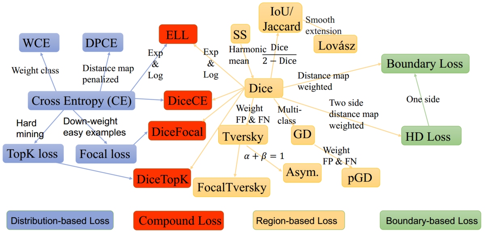

# セマンティンクセグメンテーションについて理解を深めるためメモ。

## そもそも、セマンティックセグメンテーションとは何?

画像の各ピクセルに対して、どのクラスに属するかを分類するタスクのこと。特徴抽出手法としてCNNを用いることで、推定が可能となっている。

### セマンティックセグメンテーションの学習

ここでは、セマンティックセグメンテーションの学習の際の要素についてまとめる

#### 損失

予測ピクセルと正解ピクセルがどの程度一致していて、どの程度不一致であるかを評価する指標。様々な損失関数が存在しているなか、segmentationタスクで用いられる損失関数としては、以下のようなものがある。

1. CrossEntropyLoss
2. DiceLoss
3. FocalLoss



##### CrossEntropyLoss

データ分布と予測分布という2つの確率分布の差を測る指標。誤差が大きいほど損失が大きくなる。損失関数の定義は以下の通り。

$$H(p,q) = -\sum_{x} p(x) \log q(x)$$

$I(x) = -\log q(x)$は確率q(x)において、事象が起こる(そこにそれが存在する確率)と予想される値が小さいほど大きな損失を返すとなっている。(自信がない(確率低い)ラベルが正解ラベルと一致しているときほど損失が大きくなるということ。)
例として、
正解ラベルp(x)[0,1,0]に対して、予測ラベルq(x)[0.1,0.8,0.1]の場合、損失は $$H(p,q) = -\sum_{x} p(x) \log q(x) = 0 -\log 0.8 + 0= 0.2231$$ となる。
正解ラベルp(x)[0,1,0]に対して、予測ラベルq(x)[0.8,0.1,0.1]の場合、損失は $$H(p,q) = -\sum_{x} p(x) \log q(x) = 0 -\log 0.1 + 0= 2.3025$$ となる。

##### Focal Loss

「不均衡データ(ラベルごとのデータ数の比率が大きく偏っているデータ)に対しても学習が進むようにするための損失関数」セマンティックセグメンテーションにおける不均衡データとは、画像に占める対象物体の面積が小さいデータのことを指す。実際には、CrossEntropyへの**重み($\gamma$)付け**により、正解クラスの推測結果が高い、簡単なピクセルのlossへの寄与を減らし、難しいピクセルのlossへの寄与を増やすことで、学習が進むようにする。Focal Lossの定義は以下の通り。

$$FL(P_t) = -(1-p_t)^\gamma \log(p_t), \gamma \geq 0$$

- $p_t$:モデルの予測確率の内、正解クラスの位置にある確率値(例: [0.1,0.8,0.1]の場合、正解クラスが2番目のクラスである場合、p_t=0.8)

$\gamma$が0の場合は、Focal LossはCrossEntropyLossと同じになる。$\gamma$が大きくなるほど、正解クラスの予測確率が高い場合の損失への寄与が減ることになる。(1<の値であるため指数が大きくなるほど、正解クラスの予測確率が高い場合の損失への寄与が減ることになる。)

##### Dice Loss

正解領域と推測領域の重なり具合(Dice係数)に注目して、損失を求める計算。定義は、以下の通り。

$$DC(y,\hat{p}) = = 1 - \frac{2\sum y\hat{p}}{\sum y + \sum \hat{p}}$$
$$DiceLoss = 1 - DC(y,\hat{p})$$

- $y$:正解ラベル領域
- $\hat{p}$:推測ラベル領域

分母が0にならないように分母と分子に1を足すことで、0除算を防ぐことが一般的。また、出現回数の少ないクラスのDice Lossのみを計算するということもよく行われている。

##### IoU Loss

Intersection over Union (IoU) Lossは、正解領域と推測領域の交差部分と和集合の比率に注目して損失を求める計算。定義は、以下の通り。

$$IoU(y,\hat{p}) = \frac{y \cap \hat{p}}{y \cup \hat{p}} = \frac{\sum y\hat{p}}{\sum ( y + \hat{p} - y\hat{p})}$$
$$IoULoss = 1 - IoU(y,\hat{p})$$

## 語録

### one-hotベクトル

注目したいクラスのindexに1を、それ以外のクラスのindexに0を割り当てたベクトルのこと。

#### one-hotベクトル化

```rei
target [H,W]（クラス番号）
0 1 1
0 2 1

        ↓ one-hot

ch0（背景）   ch1（実）     ch2（切断面）
1 0 0        0 1 1        0 0 0
1 0 0        0 0 1        0 1 0
```

**Ignore-indexがある場合は注意が必要。**one-hotベクトル化の際に、ignore-indexの位置は0にする必要がある。そのままone-hotベクトル化させると、範囲外となり、エラーが発生する。